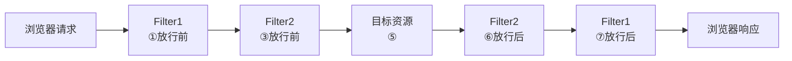

# Filter（过滤器）

Web 应用中的**拦截器**组件：请求到达目标资源之前、以及响应返回之前，都可以在此介入处理。令牌校验、编码处理等横切逻辑适合放在这里。

## 1. 快速入门

1. **定义 Filter**：定义一个类，实现 `Filter` 接口，并实现其所有方法。
2. **配置 Filter**：Filter 类上加 `@WebFilter` 注解配置拦截路径；引导类上加 `@ServletComponentScan` 开启 Servlet 组件支持。

```java
@WebFilter(urlPatterns = "/*")   // 拦截路径，/* 表示拦截所有请求
public class DemoFilter implements Filter {

    // 初始化方法：web 服务器启动、创建 Filter 实例时调用，只调用一次
    public void init(FilterConfig filterConfig) throws ServletException {
        System.out.println("init ...");
    }

    // 拦截到请求时调用该方法，可以调用多次
    public void doFilter(ServletRequest servletRequest, ServletResponse servletResponse, FilterChain chain) throws Exception {
        System.out.println("拦截到了请求...");
        chain.doFilter(servletRequest, servletResponse);   // 放行，交给下一个过滤器 / 目标资源
    }

    // 销毁方法：web 服务器关闭时调用，只调用一次
    public void destroy() {
        System.out.println("destroy ...");
    }
}
```

```java
@ServletComponentScan   // 开启 Servlet 组件支持
@SpringBootApplication
public class TliasManagementApplication { }
```

### 生命周期

| 方法 | 调用时机 | 次数 |
| --- | --- | --- |
| `init` | web 服务器启动、创建 Filter 实例时 | 一次 |
| `doFilter` | 每次拦截到请求时 | 多次 |
| `destroy` | web 服务器关闭时 | 一次 |

## 2. 过滤器链

- 一个 web 应用中可配置多个过滤器，它们形成一条**过滤器链**。
- 顺序：注解配置的 Filter，优先级按过滤器类名（字符串）的**自然排序**。



请求按 Filter 顺序**由外向内**进入，响应再**由内向外**原路返回。

`chain.doFilter(request, response)` 即**放行**：调用后继续走链上的下一个过滤器或目标资源。写在它之前的代码在**请求阶段**执行（放行前），写在它之后的代码在**响应阶段**执行（放行后）。
