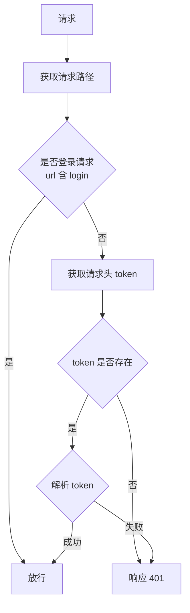

# 登录认证与 JWT

## 1. 会话跟踪的三种方案

服务端需要**记住**当前访问的是哪个用户，常见的三种方案：

| 方案 | 凭证存放 | 交互 |
| --- | --- | --- |
| Cookie | 客户端浏览器 | 请求携带 `Cookie: name=value`，响应携带 `Set-Cookie: name=value` |
| Session | 服务端（浏览器只保存 `JSESSIONID`） | 请求携带 `Cookie: JSESSIONID=1`，服务端据此找到对应 Session |
| 令牌 | 客户端（令牌自包含信息） | 请求 / 响应携带令牌，服务端校验令牌 |

### 方案对比

| 方案 | 优点 | 缺点 |
| --- | --- | --- |
| Cookie | HTTP 协议中支持的技术 | 移动端 APP 无法使用 Cookie；不安全，用户可自己禁用 Cookie；Cookie 不能跨域 |
| Session | 存储在服务端，安全 | 服务器集群环境下无法直接使用 Session；Cookie 的缺点 |
| 令牌 | 支持 PC 端、移动端；解决集群环境下的认证问题；减轻服务器端存储压力 | 需要自己实现 |

> Cookie 与 Session 属于**传统方案**，令牌是**主流方案**。
>
> Session 依赖 Cookie 传递 `JSESSIONID`，所以**继承了 Cookie 的全部缺点**；且集群下 Session 分散在各服务器本地，无法直接共享。令牌把身份信息**自包含**在令牌本身，服务端无需存储，因此天然适配集群与多端。

## 2. JWT 令牌

- 全称 **JSON Web Token**（<https://jwt.io/>）
- 定义了一种**简洁的、自包含的**格式，用于在通信双方之间以 JSON 数据格式安全地传输信息。

### 组成

令牌由三部分组成，用 `.` 分隔：

| 部分 | 内容 | 示例 |
| --- | --- | --- |
| Header（头） | 记录令牌类型、签名算法 | `{"alg":"HS256","type":"JWT"}` |
| Payload（有效载荷） | 携带自定义信息、默认信息 | `{"name":"Tom","iat":1516239022}` |
| Signature（签名） | 防止 Token 被篡改、确保安全性 | `数字签名(header.payload, secret)` |

- Header 与 Payload 经 **Base64** 编码。
- Signature 由 `header.payload` 融入**指定密钥**、按**指定签名算法**计算得到。
- Base64：一种基于 64 个可打印字符（`A-Z` `a-z` `0-9` `+` `/`）来表示二进制数据的编码方式。

> **Base64 是编码，不是加密**：Header 与 Payload 只做了 Base64 编码，任何人都能解开还原，**所以 Payload中不能存放敏感信息**。签名保证的是**防篡改**（改一个字符签名就对不上），而不是**保密**。
 
### 生成 / 解析

- 引入 `jjwt` 依赖：`io.jsonwebtoken:jjwt`
- 调用官方提供的工具类 `Jwts` 来生成或解析 JWT 令牌：

| 方法 | 作用 |
| --- | --- |
| `Jwts.builder()...` | 生成令牌 |
| `Jwts.parser()...` | 解析令牌（`setSigningKey(...)` 设置密钥） |

> 工具类的具体参数、签名算法选择等属参考性内容，随用随查官方文档 / 询问 AI 即可。

### 注意事项

- 校验时使用的**签名密钥**，必须和生成 JWT 令牌时使用的密钥**配套**。
- 令牌解析（校验）报错的两种情况：**令牌被篡改**、**令牌过期失效**。

## 3. 令牌校验流程

在 Filter 中校验请求携带的令牌：

1. 获取请求 URL。
2. 判断请求 URL 中是否包含 `login`，包含则是登录操作，**放行**。
3. 获取请求头中的令牌（token）。
4. 判断令牌是否存在，不存在则响应 **401**。
5. 解析 token，解析失败则响应 **401**。
6. 解析成功则**放行**。

> 该流程由 **Filter（过滤器）** 实现，Filter 的基本用法见 [[Filter]]。
